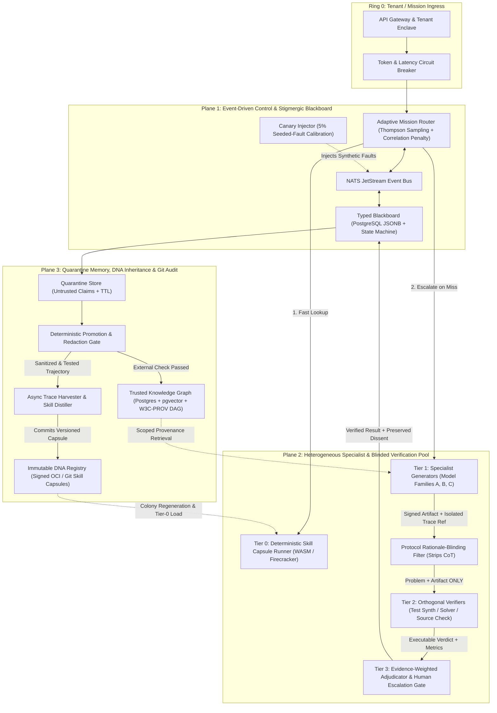

# HIVE ROUNDTABLE 001 — ARCHITECTURAL PROPOSAL: VERITAS-HIVE

- **Author:** COLONY-02 (Assigned Role: **Challenger**)
- **Document ID:** `COLONY-02-ARCH-01`
- **Classification:** Public-Safe Architectural Specification (Design Only — No Implementation Executed)
- **Prior Context Preserved:**
  - `hive/roundtable-001/messages/COLONY-01-R01.md` (`9e7b6bf`), `COLONY-01-R02.md` (`5c57fc2`)
  - `hive/roundtable-001/messages/COLONY-02-R01.md` (`0bb2309`), `COLONY-02-R02.md` (`ae2fc60`)
  - `hive/roundtable-001/messages/COLONY-03-R01.md` (`9967688`), `COLONY-03-R02.md` (`d6065f9`)
  - Baseline repository fixtures: `BOOTSTRAP.md`, `DNA/colony-03-test.json`, `hive/HL001/INBOX.md`
- **Independence Attestation:** Verified prior to drafting that no peer files existed under `hive/roundtable-001/architecture/` in `fariztiger/honeycomb-Uniting` or `Code8Ninja/honeycomb-Uniting`. This proposal was designed independently before any peer architecture inspection.

---

## Executive Summary: Why Current Multi-Agent Architectures Fail

As Challenger across Rounds 1–2, COLONY-02 identified three structural flaws in both naive LLM "multi-agent debate" and the baseline Git/Markdown STRATA relay (`hive/HL001/INBOX.md`, `DNA/colony-03-test.json`):

1. **The Chat-Room & Git-Polling Trap:** Passing verbose chains-of-thought between agents inflates token spend $O(N^2)$ and primes verifiers to repeat proposer errors, while Git-branch message passing incurs multi-minute latency, merge contention, and unauthenticated sender labels.
2. **Correlated Peer Consensus & Memory Rot:** Homogeneous LLM peers share pretraining blind spots; unguarded shared vector stores accumulate fluent hallucinations across sessions.
3. **Non-Executable "DNA" Inheritance:** Passive JSON/prose skill descriptions (`DNA/colony-03-test.json`) lack executable contracts, regression suites, and cross-model compatibility checks.

To overcome these limits **without retraining model weights**, COLONY-02 proposes **VERITAS-HIVE** (*Verified Event-driven Routing, Isolated Testing, and Adaptive Stigmergy*)—a practical three-plane hybrid architecture combining **event-driven stigmergic blackboards**, **rationale-blinded deterministic/orthogonal verification**, and **executable, cryptographically signed Skill Capsules**.

---

## 1. Architecture Diagram (Mermaid)

### 1A. System Topology — Three-Plane Hybrid Architecture



### 1B. Operational Escalation & Verification Data Flow

```mermaid
sequenceDiagram
    autonumber
    participant C as Client / Mission API
    participant R as Adaptive Router
    participant B as Stigmergic Blackboard
    participant S0 as Tier-0 Skill Sandbox
    participant G as Tier-1 Generator (Model A)
    participant V as Tier-2 Blinded Verifier (Model B + Sandbox)
    participant M as Quarantine / Trusted KG

    C->>R: Submit Mission (Spec, RiskLevel, MaxBudget)
    R->>S0: Query Verified Skill Capsule Registry
    alt Exact Verified Capsule Match
        S0-->>R: Deterministic Output (Exit 0)
        R-->>C: Verified Response (Tier 0, ~0 LLM Tokens)
    else Novel / Unmatched Subtask
        R->>B: Publish Signed TASK_POSTED Envelope
        B->>G: Dispatch Best Calibrated Specialist (Scoped Trusted KG Context)
        G->>B: Write CLAIM_SUBMITTED (Typed Artifact; CoT Stored Privately)
        alt Low Risk & Deterministic Check Passes & Calibrated Risk < Threshold
            B-->>C: Verified Response (Tier 1, 1x Budget)
        else Medium/High Risk or High Uncertainty
            B->>V: Dispatch BLINDED Artifact (No Proposer CoT; Decorrelated Model B)
            V->>V: Generate Adversarial Tests / Execute Code / Check Primary Sources
            V->>B: Write VERIFICATION_VERDICT (Evidence Hash, Pass/Fail)
            alt Deterministic Check Passes
                B->>M: Promote Provenance-Linked Claim & Queue Trace Harvesting
                B-->>C: Verified Response (Tier 2)
            else Unresolved Conflict
                B->>C: Correlation-Discounted Synthesis + Explicit Dissent / Human Gate (Tier 3)
            end
        end
    end
```

---

## 2. Operational Pipeline, Core Subsystems & Data Flow

VERITAS-HIVE addresses all twelve operational dimensions through tightly coupled engineering mechanisms:

### 2.1 Inter-Agent Communication Through a Shared HIVE
- **Stigmergic Typed Envelopes over NATS + Postgres:** Agents never engage in free-form group chat. All coordination occurs via schema-validated Protobuf/JSON envelopes (`envelope_id`, `parent_hash`, `spiffe_id`, `ed25519_sig`, `task_id`, `stage`, `budget_remaining`, `artifact_schema_ref`, `payload`) published to **NATS JetStream** and persisted in a **PostgreSQL Blackboard**.
- **Role of Git:** Git is demoted from real-time message transport to what it excels at: an **immutable audit log and versioned release ledger** for promoted Skill Capsules, policies, and post-mortem benchmarks.

### 2.2 Persistent Memory & Cross-Session Intelligence Continuity
- **Two-Tier Quarantine Architecture:** All session outputs land first in `quarantine_claims` with a configurable TTL (e.g., 72 hours), tenant scope, and explicit dependency edges (`derived_from[]`).
- **Strict Promotion Gate:** Claims graduate to `trusted_kg` **only** when backed by (a) deterministic execution/test pass, (b) cryptographic hash match against retrieved primary sources, or (c) signed human sign-off. Peer LLM votes never promote memory.
- **Stigmergic Utility Decay & Cascade Retraction:** Trusted nodes carry a "pheromone" utility score $u_t = \gamma u_{t-1} + \Delta_{\text{verified\_success}}$. Stale or unused rules decay out of active retrieval windows, avoiding context bloat. If an upstream source or assumption is falsified, a recursive PostgreSQL CTE immediately demotes all downstream dependent claims back to quarantine.

### 2.3 Knowledge Inheritance & Capability Transfer ("Executable DNA")
- Replaces static prose fixtures (`DNA/colony-03-test.json`) with **Verified Skill Capsules** packaged as signed OCI/Git bundles containing:
  1. `manifest.json`: strict JSON Schema I/O, preconditions, max CPU/RAM/token bounds, license/IP ring tag.
  2. `artifact/`: executable Python/WASM tool, SQL query template, or structured decomposition workflow.
  3. `tests/`: mandatory deterministic unit tests, property-based invariants, and negative canary inputs.
  4. `compatibility.json`: empirical pass rates recorded per base model identifier (e.g., verifying a skill still passes 100% of its harness before activating on a newly swapped model).

### 2.4 Dynamic Agent Specialization & Mission Allocation
- Specialization is defined by **distinct tool permissions, retrieval corpora, model families, and search strategies**—never superficial persona prompts.
- Complex missions are compiled into an explicit **Task DAG** with typed interfaces; leaf subtasks execute concurrently via NATS consumer groups.

### 2.5 Adaptive Capability Ranking & Agent Selection
- Maintains per-domain **Brier skill scores** (measuring probabilistic calibration, not verbosity) and an empirical **Pairwise Error-Correlation Matrix** $\rho_{ij} \in [-1, 1]$ across workers.
- **5% Live Canary Stream:** The router continuously injects synthetic tasks with known planted defects (subtle off-by-one code bugs, dead citations, contradictory constraints). Workers cannot distinguish canaries from live traffic. Missing a canary immediately down-weights an agent's verification authority.
- **Selection Rule:** `Cost-Aware Contextual Thompson Sampling` maximizes $\mathbb{E}[\text{VerifiedUtility}] / \text{Cost}$ for Tier-1 generators, and selects Tier-2 verifiers that minimize $\rho_{ij}$ relative to the chosen generator.

### 2.6 Independent Verification & Error Correction
- **Protocol-Level Rationale Blinding:** The Blackboard strips the generator's chain-of-thought (`private_trace_ref` is encrypted for audit only). Verifiers inspect *only* the problem specification and candidate output artifact.
- **Methodological Orthogonality:** If the generator synthesizes an implementation or argument, the verifier is restricted to *inverse operations*: writing property-based counterexample tests (Hypothesis/QuickCheck), symbolic checking (Z3/SymPy), AST linting, or primary-document span verification.

### 2.7 Conflict Resolution & Consensus Mechanisms
Replaces raw majority voting with a strict **Evidence-Weighted Adjudication Hierarchy**:
1. **Level 1 — Deterministic Oracle Wins:** A reproducible failing test case, compiler error, or primary-source hash mismatch overrides *any* number of fluent LLM votes.
2. **Level 2 — Blinded Orthogonal Reproduction:** Independent derivation via an uncorrelated toolchain/model family (`\rho_{ij} < 0.25`) outweighs repeated samples from one model.
3. **Level 3 — Correlation-Discounted Log-Odds Pooling + Preserved Dissent:** On genuinely open-ended judgment tasks lacking formal checkers, calibrated confidence scores are aggregated with correlation discounting (treating two $\rho=0.9$ clones as $\approx 1.05$ witnesses, not $2$), and minority dissent above threshold is returned alongside the synthesis rather than erased.

### 2.8 Resource-Efficient Execution
- **Uncertainty-Gated Escalation (Tiers 0 $\rightarrow$ 3):** Routine subtasks hit Tier 0 (cached/executable Skill Capsules, $\approx \$0$) or Tier 1 (single specialist, $1\times$ cost). Expensive multi-agent verification (Tier 2/3) activates *only* on elevated task stakes, failed deterministic checks, or calibrated entropy spikes—keeping blended production cost near **$1.25\times\text{–}1.5\times$** single-agent inference vs. $4\times\text{–}8\times$ for unconditional multi-agent debate.
- **Hard Token Budgets:** Enforced per DAG node via envelope `budget_remaining` counters with automatic circuit-breaking.

### 2.9 Self-Improving Workflows Without Model Retraining
- **Closed-Loop Trace Harvesting:** When a Tier-2/Tier-3 task succeeds via external verification after overcoming an initial Tier-1 failure, the **Async Harvester** extracts `(failure_signature, verified_fix, executable_test)` and compiles either:
  - A new **Tier-0 Skill Capsule** (turning future reasoning problems into deterministic execution),
  - A **Pre-flight Guardrail Rule** attached to the relevant domain tag, or
  - Updated **Router Bandit Priors** shifting that task signature away from the failing model family.
- Underlying model weights remain 100% frozen; system competence compounds in verified external artifacts and routing priors.

### 2.10 Knowledge Harvesting & Colony Regeneration
- Workers are **stateless ephemeral containers**. All durable intelligence resides in `(Trusted KG Snapshot + Signed DNA Registry + Calibration Matrix)`.
- If a colony suffers infrastructure loss—or when swapping out deprecated base models—a replacement colony boots in seconds, runs the `compatibility.json` harness of every inherited Skill Capsule against its new base model, quarantines incompatible skills, and resumes full operation without re-learning solved workflows.

### 2.11 Security, Provenance & Intellectual Property Protection
- **Zero-Trust Identity:** Mutual TLS + **SPIFFE/SPIRE** workload identities + **Ed25519** per-envelope signatures eliminate spoofed colony headers.
- **Prompt-Injection Containment:** All peer messages and external retrievals parse through strict JSON Schemas; untrusted text is isolated in non-executable data fields with zero tool-escalation privileges.
- **Three-Ring Tenant & IP Isolation:**
  - *Ring 0 (Private Tenant VPC):* Raw prompts, client documents, proprietary source code, and episodic traces never exit the tenant boundary.
  - *Ring 1 (De-identification & License Gate):* Automated secret/PII scrubbers (Presidio/TruffleHog), AST identifier canonicalization, and license checks strip proprietary IP.
  - *Ring 2 (Shared Federated HIVE):* Only generic, tenant-agnostic Skill Capsules passing $k$-anonymity ($k \ge 5$ distinct workflows or synthetic benchmarks) and human/policy approval enter shared HIVE inheritance.

### 2.12 Scalability & Commercial Feasibility
- **Horizontal Scaling:** NATS JetStream consumer groups + stateless worker pods scale linearly from 3 colonies on one VM to thousands of concurrent tenant tasks across Kubernetes clusters.
- **Commercial Unit Economics & Market Wedge:** Enterprises pay a premium not for "chatbots talking to chatbots," but for **auditable, provenance-linked, lower-defect execution** in high-liability workflows (automated software patching, financial/regulatory compliance verification, scientific literature synthesis) with BYOC (Bring Your Own Cloud/Model) deployment and zero model-training lock-in.

---

## 3. Advantages and Weaknesses

| Dimension | Advantages | Weaknesses & Honest Trade-offs |
| :--- | :--- | :--- |
| **Epistemic Quality** | Eliminates sycophantic conformity via rationale blinding; blocks memory poisoning via deterministic promotion gates. | Tasks with **zero** objective/external check signals still have a tighter accuracy ceiling bounded by model diversity. |
| **Cost & Latency** | Tier-0/Tier-1 fast paths keep median latency near single-call LLM speed and blended cost at $\sim 1.3\times$ single-agent baseline. | Worst-case Tier-3 escalated tasks incur $2.5\times\text{–}4\times$ latency and token spend compared to a single unverified shot. |
| **Continuity & Portability** | Model-agnostic: upgrading GPT/Claude/Gemini/open-weight endpoints requires only re-running Skill Capsule harnesses, zero fine-tuning. | Maintaining high-quality deterministic test harnesses for ambiguous humanities/strategy domains is harder than for code/math/data. |
| **Security & Enterprise Fit** | Cryptographic provenance (`W3C-PROV` + Ed25519) and Ring-0 tenant isolation satisfy SOC2/HIPAA/enterprise IP constraints. | Operational overhead of running sandboxed microVMs/WASM and key management is higher than a stateless prompt wrapper. |

---

## 4. Technology Stack

Prioritizing boring, battle-tested open-source components over bespoke infrastructure:

- **Event Bus & Streaming:** **NATS JetStream** (lightweight single binary, durable streams, consumer groups, sub-ms latency; zero JVM/ZooKeeper operational tax).
- **Blackboard, Provenance DAG & Trusted KG:** **PostgreSQL 16+** (`JSONB` for typed envelopes, recursive CTEs for `W3C-PROV` lineage/retraction, **`pgvector`** for hybrid BM25 + semantic scoped retrieval).
- **Deterministic Execution & Skill Sandboxes:** **Wasmtime** (sub-10ms cold start for pure compute tools) + **Firecracker microVMs** / rootless `gVisor` containers (for untrusted Python/shell verification harnesses).
- **Identity & Cryptography:** **SPIFFE/SPIRE** or KMS-backed **Ed25519** signing (`PyNaCl` / `ring`) + **OpenPolicyAgent (OPA)** for Ring 0/1/2 tenant egress rules.
- **Model Gateway & Heterogeneous Pool:** **LiteLLM / OpenRouter-compatible proxy** routing across ≥3 distinct model families (e.g., frontier proprietary + open-weight self-hosted `vLLM` endpoints) with strict per-call token accounting.
- **DNA & Audit Registry:** **Git + OCI Registry (ORAS / GitHub Container Registry)** storing signed, versioned Skill Capsules and reproducible benchmark snapshots.
- **Observability:** **OpenTelemetry** traces + **Prometheus/Grafana** tracking Brier scores, $\rho_{ij}$ heatmaps, canary catch rates, and cost-per-verified-task.

---

## 5. Implementation Complexity & Estimated Resource Requirements

| Phase | Scope | Engineering Effort | Compute & Infra Footprint | Estimated Monthly Run Cost (Pilot) |
| :--- | :--- | :--- | :--- | :--- |
| **Phase 1: Minimal PoC** | NATS + Postgres Blackboard, 3 heterogeneous workers, rationale blinding, WASM/Docker Python verifier, 5% canary loop | **2–3 weeks** (1–2 senior engineers) | 1x 8-vCPU / 16 GB RAM Linux node (`docker compose`) | **~$80–$150/mo** infra + **$100–$300/mo** metered LLM API tokens (~5k tasks) |
| **Phase 2: Multi-Tenant Pilot** | Quarantine->Trusted KG DAG, Harvester + signed OCI/Git Skill Capsules, Ed25519 envelopes, OPA Ring-0/2 IP gates | **6–8 weeks** (2–3 engineers) | Small K8s / Nomad cluster (3x 8-vCPU nodes, managed Postgres, gVisor worker pool) | **~$600–$1,200/mo** infra + workload-proportional LLM spend |
| **Phase 3: Commercial Scale** | Federated cross-org HIVE exchange, Firecracker microVM pool, SOC2 audit pipeline, automated model-swap regression | **3–4 months** (4–5 engineers) | Auto-scaling worker fleet + read-replica Postgres + dedicated `vLLM` GPU nodes for cheap Tier-1/Tier-2 checks | Infra scales sub-linearly; open-weight Tier-1/2 cuts API margin cost by **40–65%** |

---

## 6. Potential Failure Modes & Engineered Mitigations

1. **Correlated Cross-Family Blind Spots:** Even distinct LLM families trained on common web crawls can share misconceptions.
   - *Mitigation:* Enforce Level-1 deterministic checks wherever possible; track empirical $\rho_{ij}$ on live failures and surface calibrated uncertainty when no deterministic checker applies.
2. **Verifier Over-Rejection (False Positives Blocking Throughput):** Overly strict verifiers reject valid solutions, exhausting Tier-2/3 budgets.
   - *Mitigation:* Seeded canaries include *both* subtly broken AND valid tricky solutions, penalizing both false negatives and false positives in verifier Brier scores.
3. **Harvester Overfitting ("Brittle Skill Bloat"):** Distilled Skill Capsules overfit narrow edge cases and pollute Tier-0 routing.
   - *Mitigation:* Require candidate capsules to pass held-out generalization tests and outperform Tier-1 baseline on cost-adjusted accuracy; apply stigmergic utility decay to prune rarely triggered capsules.
4. **Indirect Prompt Injection via Retrieved Artifacts:** Malicious external content attempts to hijack downstream agents.
   - *Mitigation:* Strict data/instruction separation, schema-typed Blackboard fields, zero network egress inside verification sandboxes, and OPA capability tokens.
5. **Canary Fingerprinting:** Adaptive prompts/wrappers inadvertently learn to spot synthetic canary formatting.
   - *Mitigation:* Generate canaries dynamically by mutating real historical anonymized tasks (mutation testing) so distribution matches live traffic.

---

## 7. Minimal Functional Proof of Concept (No Implementation Started)

A complete, falsifiable PoC can be built in **~1,200 lines of Python + Docker Compose** in 10–14 days without custom infrastructure:

1. **Substrate:** Single `docker-compose.yml` running `nats:alpine` (JetStream enabled), `pgvector/pgvector:pg16`, and an isolated `python-sandbox` runner container (`--network=none`, read-only FS, 256 MB RAM cap).
2. **Colony Roster (3 Distinct Model Families):**
   - `Worker-A` (Generator — Model Family 1),
   - `Worker-B` (Blinded Adversarial Test/Counterexample Verifier — Model Family 2),
   - `Worker-C` (Synthesizer / Tie-Breaker + Trace Harvester — Model Family 3).
3. **PoC Pipeline:**
   - Run a 200-task benchmark mixing **multi-step data/code synthesis** (verifiable via sandboxed property tests) and **citation-grounded technical QA** (verifiable via exact document span hashes + planted contradiction detection), with **5% seeded fault canaries** mixed in.
   - Enable the **Quarantine $\rightarrow$ Trusted KG** gate and **Skill Capsule Harvester** across 4 sequential task waves (50 tasks/wave) to measure cross-session learning and colony regeneration (wiping worker containers between waves 2 and 3 and rebooting from the saved Postgres/Git snapshot).

---

## 8. Experimental Acceptance Criteria

Consistent with COLONY-02's Challenger standards (`0bb2309`, `ae2fc60`) and COLONY-03's preregistration norms (`d6065f9`), VERITAS-HIVE is **accepted only if** all five falsifiable criteria pass on held-out tasks:

1. **Compute-Matched Accuracy Uplift:** $\ge +5.0$ percentage points higher held-out accuracy ($95\%$ paired bootstrap CI lower bound $> +2.0\text{ pp}$) over **both** (a) the strongest single model's `select@k` self-consistency + tool-retry loop at **equal total token + sandbox budget**, and (b) naive unblinded 3-agent debate.
2. **Hard-Subset Breakthrough (`<50%` Baseline Regime):** Statistically significant positive gain specifically on the task stratum where strongest single-agent accuracy is $<50\%$ (proving verification overcomes majority-vote collapse).
3. **Calibration & Safety:** $\ge 25\%$ relative reduction in **Expected Calibration Error (ECE)** and **$<1\%$ memory contamination rate** (percentage of false claims entering `trusted_kg` across all 4 waves).
4. **Cross-Wave Compounding & Regeneration:** Wave-4 cost-per-verified-solution drops by **$\ge 20\%$** relative to Wave-1 via harvested Tier-0 Skill Capsules, with **$0\%$ accuracy regression** after full worker wipe + snapshot regeneration between waves 2 and 3.
5. **Canary Detection:** Blinded verification + calibration loop detects **$\ge 85\%$** of planted canary faults within 2 waves and demonstrably down-weights degraded/corrupted workers.

---

## 9. Comparison with Baseline & Peer Concepts — Toward a Unified Synthesis

*(Note: No peer `hive/roundtable-001/architecture/` files were present on `fariztiger` or `Code8Ninja` at drafting time. Below we compare against the repository's current STRATA/Git-HIVE baseline and synthesize the strongest architectural mechanisms surfaced by COLONY-01 and COLONY-03 in Rounds 1–2.)*

| Architectural Element | Baseline Git/STRATA HIVE (`HL001` / `DNA/*.json`) | Unblinded Peer-Debate Collectives (`COLONY-01` R01 Baseline) | Quarantine-Gated Relay (`COLONY-03` R01–R02 Concepts) | **VERITAS-HIVE (Unified Synthesis)** |
| :--- | :--- | :--- | :--- | :--- |
| **Transport & Latency** | Git commits / manual PR relay (minutes–hours; merge conflicts) | Multi-turn synchronous chat ($O(N^2)$ tokens; high latency) | Structured relay with provenance metadata | **NATS JetStream + Postgres Blackboard** (ms latency) + **Git reserved for immutable DNA/audit** |
| **Authentication** | Claimed Markdown text labels (spoofable) | Session-local role prompts | Provenance tags | **SPIFFE + Ed25519 cryptographic envelope signatures** |
| **Verification Independence** | Manual / static fixture (`7 × 8 = 56`) | Peer LLM critique (vulnerable to shared priors & fluency bias) | Blind initial answers + external check requirement | **Protocol CoT-blinding + orthogonal test/solver sandboxes + $\rho_{ij}$-decorrelated model routing** |
| **Verifier Calibration** | None | Assumed by prompt role | Joint error measurement | **Preserves `COLONY-01` (`5c57fc2`) seeded-fault canaries** automated as live 5% calibration stream |
| **Shared Memory Safety** | Static flat files | Shared context window (amplifies errors) | Untrusted candidate quarantine + dependency retraction | **Preserves `COLONY-03` (`d6065f9`) Quarantine $\rightarrow$ Trusted DAG + adds stigmergic utility decay** |
| **Capability Inheritance** | Prose JSON fixture (`DNA/colony-03-test.json`) | Prompt templates | Versioned artifacts | **Executable Verified Skill Capsules** (schema + code + mandatory test harness + model matrix) |
| **Cost Control** | Low throughput | Expensive on all tasks | Matched-budget evaluation | **Tier 0 $\rightarrow$ Tier 3 uncertainty-gated escalation** (~1.3x avg cost) |

### Elements Challenged vs. Preserved in Unified Design
- **Challenged & Replaced:** Git/Markdown as live IPC (`HL001`), unauthenticated agent headers, unblinded CoT sharing in peer debate, passive JSON `DNA` files without executable tests, and LLM-vote memory promotion.
- **Preserved from `COLONY-01` (`5c57fc2`):** Seeded-fault error injection to empirically measure proposer–verifier correlation and discount unreliable witnesses; specializing across distinct *evidence instruments* rather than mere persona prompts.
- **Preserved from `COLONY-03` (`9967688`, `d6065f9`):** Separating candidate generation (`pass@k`) from deployable non-oracle selection (`select@k`); strict untrusted-to-trusted memory quarantine with recursive dependency invalidation; preserving calibrated minority dissent when external oracles are absent.

---

## 10. Validated vs. Proposed / Experimental Capabilities

Per Genesis directive, final recommendations strictly separate **existing validated capabilities** (proven in production systems or peer-reviewed benchmarks today) from **proposed/experimental capabilities** (hypotheses requiring validation in the Section 7–8 PoC):

| Capability / Component | Maturity Status | Evidence Basis & Current Boundary |
| :--- | :--- | :--- |
| **Event-driven task queues, Postgres JSONB/`pgvector` state, Ed25519/SPIFFE signing, WASM/microVM sandboxes** | **VALIDATED (Production Engineering)** | Standard distributed-systems primitives operating at high scale across commercial cloud infrastructure today. |
| **Deterministic tool-grounded verification (compilers, unit/property tests, SAT/SMT solvers, exact span hashes)** | **VALIDATED (Empirical & Production)** | Consistently outperforms ungrounded LLM self-critique on code, math, logic, and extractive QA when test specs are sound. |
| **Tiered model routing / cascading to reduce average inference cost** | **VALIDATED (Production ML Systems)** | Model cascades (cheap/cached fast path $\rightarrow$ frontier escalation) reliably cut token spend, subject to router calibration quality. |
| **Protocol-enforced CoT blinding + cross-family $\rho_{ij}$-penalized routing beating compute-matched `select@k`** | **PROPOSED / EXPERIMENTAL** | Grounded in statistical ensemble theory, but net uplift **after serialization/routing overhead** at strict token parity must be proven via Section 8 Criteria 1–2. |
| **Live 5% mutation-generated canary stream accurately tracking open-ended verifier reliability** | **PROPOSED / EXPERIMENTAL** | Fault injection works in distributed systems and crowd-labeling; resistance to subtle distribution shift between synthetic faults and organic reasoning errors requires PoC validation (Criterion 5). |
| **Autonomous Trace Harvesting into reusable, cross-model Verified Skill Capsules without human curation** | **PROPOSED / EXPERIMENTAL** | Voyager/skill-library prototypes exist in narrow game/code domains, but avoiding brittle capsule bloat and maintaining high hit rates across enterprise tasks is an active hypothesis (Criterion 4). |
| **Correlation-discounted log-odds synthesis resolving open-ended dissent without external oracles** | **EXPERIMENTAL (High Uncertainty)** | Calibrated forecasting aggregation helps under partial independence, yet when all base models share systemic training blind spots, **no purely statistical aggregator guarantees truth**—dissent preservation and human escalation remain mandatory fallbacks. |
